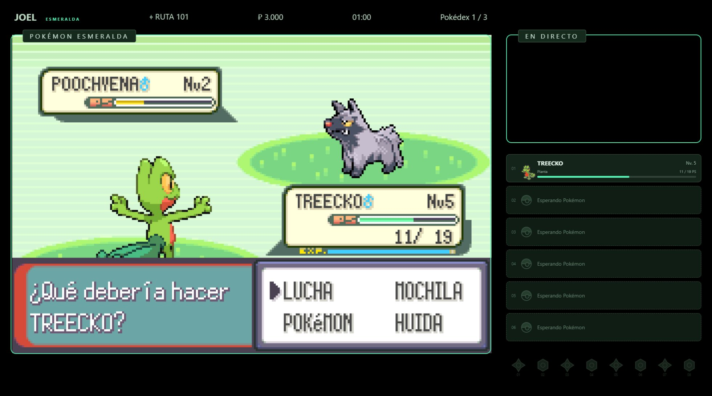
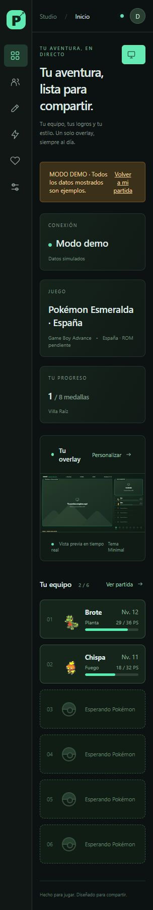

<p align="center"></p>

# PokeStream Overlay

Overlays automáticos para Pokémon y OBS, desde una aplicación local con panel web en español. El equipo, las medallas y los datos de la partida se actualizan a partir de la memoria del emulador.

**PokeStream es completamente gratuito y de código abierto, hecho por y para la comunidad.** Puedes usarlo, compartirlo y contribuir con ideas, propuestas de juegos o mejoras.

**Por ahora solo admite juegos de Game Boy Advance (GBA).** Está previsto añadir soporte para **Nintendo DS**, sin fecha confirmada. Puedes proponer juegos y mejoras en la pestaña **Issues** de este repositorio de GitHub.

## Índice

- [Capturas](#capturas)
- [Juegos compatibles](#juegos-compatibles)
- [Qué puedes hacer](#qué-puedes-hacer)
- [Cómo funciona](#cómo-funciona)
- [Instalación desde el ejecutable (.exe)](#instalación-desde-el-ejecutable-exe)
- [Instalación desde código](#instalación-desde-código)
- [Configurar mGBA y el overlay](#configurar-mgba-y-el-overlay)
- [Probar ROM](#probar-rom)
- [Cerrar PokeStream](#cerrar-pokestream)
- [Problemas frecuentes](#problemas-frecuentes)
- [Informar de errores y proponer juegos](#informar-de-errores-y-proponer-juegos)
- [Desarrollo y pruebas](#desarrollo-y-pruebas)
- [Compilar y preparar una publicación](#compilar-y-preparar-una-publicación)
- [Licencia y documentación](#licencia-y-documentación)

## Capturas

### Overlay en OBS

Ejemplo compartido por un usuario: Pokémon Esmeralda con la captura del juego, el equipo y los datos de la partida.



### Panel web

Captura real del panel en vista compacta y **modo demo**, con datos simulados. Desde la web puedes consultar la partida, personalizar el overlay y configurar PokeStream.



## Juegos compatibles

Solo se reconocen las siguientes ROMs originales españolas:

| Juego | Revisiones reconocidas | Prueba con ROM real |
| --- | --- | --- |
| Pokémon Esmeralda | 0 | Arranque y datos iniciales |
| Pokémon Rubí | 0 y 1 | Revisión 1 |
| Pokémon Zafiro | 0 y 1 | Revisión 0 |
| Pokémon Rojo Fuego | 0 | Arranque y datos iniciales |
| Pokémon Verde Hoja | 0 | Arranque y datos iniciales |

La revisión se identifica por el contenido del archivo, no por su nombre. Otros idiomas, ROM hacks y archivos modificados no están soportados. Los conectores nuevos son experimentales: equipo, combates, capturas, evoluciones y medallas todavía requieren validación completa con partidas reales. Reconocer una ROM no significa haber probado una partida entera.

## Qué puedes hacer

- Mostrar equipo, PS, nivel, estado, entrenador, dinero, ubicación, reloj y Pokédex.
- Personalizar posiciones, tamaños, visibilidad, color, opacidad y tema del overlay.
- Guardar perfiles e importar o exportar su configuración.
- Mostrar alertas y consultar el historial de eventos.
- Revisar registros Nuzlocke de Pokémon debilitados y confirmar o descartar cada caso.
- Probar una ROM y cerrar el servidor desde Configuración.
- Explorar el panel en modo demo, identificado como datos simulados.

## Cómo funciona

```text
mGBA + script Lua → TCP local → Python / FastAPI → WebSocket → panel web y OBS
```

El script Lua **solo lee memoria**: no envía controles ni modifica el juego. Python valida las lecturas y prepara el estado del overlay. Los nombres, tipos, ubicaciones e iconos se extraen de tu propia ROM y se guardan localmente. El navegador recibe datos de la partida, no bloques de memoria.

El servidor web escucha en `127.0.0.1:8765`; el script Lua usa `127.0.0.1:8766`. No hacen falta cuentas ni servicios en la nube. Los ajustes, perfiles, historial y recursos generados se guardan en `data/`. Mantén el servicio en localhost; no está diseñado para exponerse a Internet.

## Instalación desde el ejecutable (.exe)

Es la opción recomendada para usar PokeStream en **Windows de 64 bits**. No necesitas instalar Python, Node.js ni compilar el código.

Necesitas **mGBA 0.10.5 Qt con Scripting**, tu propia ROM compatible en formato `.gba` y OBS con fuente Navegador si quieres usar el overlay en una emisión. Las pruebas se han realizado con mGBA portable para Windows de 64 bits; otras versiones del emulador no se han verificado. Puedes descargarlo desde la [web oficial de mGBA](https://mgba.io/downloads.html).

1. Abre la sección **Releases** de este repositorio y descarga `PokeStream.exe` de la versión que quieras usar.
2. Descarga también el script puente **`pokestream.lua`** de esa misma Release. Si no aparece como archivo adjunto, abre `bridge/mgba/pokestream.lua` en el código de la etiqueta de esa versión y pulsa **Download raw file**. El [script del repositorio](bridge/mgba/pokestream.lua) puede corresponder a una versión más reciente que tu ejecutable.
3. Crea una carpeta con permiso de escritura, por ejemplo `PokeStream` dentro de Documentos, y guarda allí el ejecutable. Crea las subcarpetas `bridge/mgba/` y guarda el script dentro, manteniendo el nombre `pokestream.lua`.
4. Crea la subcarpeta `roms/` junto al ejecutable y coloca dentro tus ROMs `.gba`, sin comprimir. El emulador, las ROMs, BIOS y partidas no se incluyen en la descarga.
5. Abre `PokeStream.exe`. Se creará la carpeta `data/`, se prepararán los recursos de las ROMs reconocidas y se abrirá el panel en <http://127.0.0.1:8765/dashboard>. Si el navegador no se abre, entra manualmente en esa dirección.
6. Sigue los pasos de [Configurar mGBA y el overlay](#configurar-mgba-y-el-overlay) para cargar el puente y añadir la fuente a OBS.

La carpeta quedará así:

```text
PokeStream/
├── PokeStream.exe
├── bridge/
│   └── mgba/
│       └── pokestream.lua
├── roms/
│   └── tu-juego.gba
└── data/                 ← se crea al iniciar
```

El ejecutable actual también lleva una copia del puente: al iniciarse lo extrae a `bridge/mgba/pokestream.lua` y lo actualiza si es distinto. Por tanto, si solo has descargado el `.exe`, puedes cargar el script que genera. La descarga separada permite obtenerlo directamente desde Releases o desde el código de esa versión.

Para actualizar, usa **Configuración → Cerrar PokeStream**, sustituye el `.exe` y el puente por los de la nueva Release y vuelve a abrir la aplicación. Conserva `data/` y `roms/` para mantener tus ajustes y archivos.

## Instalación desde código

El flujo de instalación y empaquetado está preparado para **Windows**. Necesitas:

- Python 3.12 o posterior.
- Node.js 22 o posterior, con npm.
- **Emulador recomendado: mGBA 0.10.5, edición Qt con Scripting**. Todas las pruebas con ROMs reales se han realizado con la versión portable para Windows de 64 bits. Puedes descargarlo desde la [web oficial de mGBA](https://mgba.io/downloads.html).
- OBS con fuente Navegador.
- Tu propia ROM compatible, en formato `.gba`, sin comprimir.

La edición del emulador debe incluir **Scripting** para cargar el conector Lua de PokeStream. Otras versiones de mGBA no se han verificado.

Descarga o clona este repositorio y abre una terminal en su carpeta. Ejecuta `Instalar.cmd` o:

```powershell
powershell -ExecutionPolicy Bypass -File scripts/install.ps1
```

Si Python no está en PATH, puedes indicar su ejecutable:

```powershell
powershell -ExecutionPolicy Bypass -File scripts/install.ps1 -Python 'C:\ruta\python.exe'
```

La instalación crea `.venv`, instala las dependencias y compila el panel. Necesita conexión a Internet para descargar las dependencias; el funcionamiento habitual es local.

## Configurar mGBA y el overlay

1. Coloca tus ROMs en la carpeta `roms/`. No se incluyen ni se descargan ROMs, BIOS, partidas ni emuladores.
2. Abre `PokeStream.exe` si lo descargaste de Releases, o `Iniciar PokeStream.cmd` si instalaste desde código. El panel se abre en <http://127.0.0.1:8765/dashboard> y se preparan los recursos de las ROMs reconocidas.
3. Abre mGBA Qt y carga tu ROM.
4. En **Herramientas / Tools → Scripting → File → Load script**, selecciona `bridge/mgba/pokestream.lua`.
5. Inicia o continúa tu partida y deja la emulación en marcha. La consola Lua indicará `PokeStream: backend conectado`.
6. En OBS, añade una fuente **Navegador** con `http://127.0.0.1:8765/overlay?profile=default` y tamaño **1920 × 1080**.
7. Añade la captura de mGBA y, si la usas, la webcam como fuentes separadas **debajo del overlay**.
8. En el **Diseñador**, ajusta tu composición y pulsa **Guardar cambios**. Usa **Abrir vista previa** para comprobarla.

Si eliges 2560 × 1440 en el perfil, usa ese mismo tamaño en OBS. Al cambiar de juego, abre la nueva ROM y recarga el script Lua; la URL del overlay permanece igual. Los perfiles nuevos tienen su propia URL, disponible en el panel.

### Probar ROM

En **Configuración → Probar ROM**, elige un archivo `.gba`. Se comprueban tamaño, cabecera e integridad del archivo completo frente a las ROMs reconocidas. El archivo se lee en el navegador, sin subirlo ni modificarlo. El resultado distingue un original compatible, un archivo alterado y un juego no reconocido. No ejecuta el juego ni valida tu partida guardada.

### Cerrar PokeStream

En **Configuración → Cerrar PokeStream**, el botón termina el proceso del servidor y libera localhost. La web muestra el cierre y OBS deja de recibir datos. mGBA y tu partida siguen abiertos. Para volver a usarlo, abre `PokeStream.exe` o `Iniciar PokeStream.cmd`.

## Problemas frecuentes

| Problema | Qué comprobar |
| --- | --- |
| Sin conexión | PokeStream abierto, mGBA Qt, script Lua cargado y emulación en marcha. |
| Esperando partida | Entra en una partida; la pantalla de título todavía no proporciona todos los datos. |
| ROM no compatible | Usa Probar ROM; revisa juego, idioma y revisión de la tabla anterior. |
| Faltan iconos o nombres | Pon la ROM en roms y reinicia PokeStream para preparar su catálogo. |
| Puerto ocupado | Cierra otras instancias de PokeStream o de mGBA con el script cargado. |
| Overlay negro o desactualizado en OBS | Comprueba URL, tamaño y componentes visibles; actualiza la caché de la fuente Navegador. |
| Web desactualizada | Recarga con Ctrl+F5 después de actualizar el ejecutable. |
| Lectura rechazada | Consulta Configuración → diagnóstico técnico y el fragmento relevante de data/pokestream.log. |

El frontend se compila para Chromium 75 y se ha comprobado también en Chromium actual. Esto busca compatibilidad con OBS antiguo y actual, pero no equivale a verificar todas las versiones de OBS.

**Savestates:** una carga hacia delante puede confundirse con progreso real. Desactiva las alertas antes de usar savestates y recarga el script después. Los registros Nuzlocke siempre requieren revisión manual.

### Informar de errores y proponer juegos

Si algo falla, **abre un issue en GitHub**, en la pestaña **Issues** de este repositorio, usando la plantilla de error. Indica los pasos, resultado esperado, versiones de PokeStream, Windows, mGBA y OBS, y el juego con su idioma y revisión. Una captura o un fragmento de diagnóstico puede ayudar.

Para solicitar otro juego, soporte de Nintendo DS o una mejora, usa la plantilla **Proponer un juego o una mejora**. Revisa primero si ya existe una propuesta similar.

**No adjuntes ROMs, BIOS, partidas ni la carpeta data completa.** Oculta nombres de usuario, rutas personales y cualquier credencial en capturas y registros.

## Desarrollo y pruebas

```powershell
powershell -ExecutionPolicy Bypass -File scripts/dev.ps1
.\.venv\Scripts\python.exe -m pytest -q
npm.cmd test --prefix frontend
```

Para trabajar con recarga automática, deja el backend abierto y ejecuta `npm.cmd run dev --prefix frontend` en otra terminal. Abre <http://127.0.0.1:5173/dashboard>.

Las pruebas normales no necesitan ROMs. Las pruebas de integración adicionales de `tests/test_retail_roms.py` solo se ejecutan cuando existen archivos `.gba` propios en `roms/`; nunca se incluyen en el repositorio. GitHub Actions ejecuta las pruebas sintéticas y la compilación.

## Compilar y preparar una publicación

```powershell
powershell -ExecutionPolicy Bypass -File scripts/build.ps1
.\.venv\Scripts\python.exe scripts/verify_package.py
.\.venv\Scripts\python.exe scripts/export_source.py
```

`dist/PokeStream.exe` contiene el panel y el bridge, sin ROMs, emuladores, partidas ni recursos extraídos. Colócalo en una carpeta con permiso de escritura. Al iniciarlo crea `data/` y extrae el script Lua. Conserva LICENSE y los avisos de dependencias cuando distribuyas ejecutables.

Para publicar una Release en GitHub, adjunta `dist/PokeStream.exe` y `bridge/mgba/pokestream.lua` de la misma versión, junto con LICENSE y los avisos de dependencias. Así los usuarios podrán descargar el ejecutable y el puente por separado siguiendo la guía anterior.

`dist/PokeStream-source.zip` es el código preparado para publicar mediante una lista explícita de archivos permitidos. **No subas la carpeta de trabajo completa:** contiene tus ROMs y datos privados. El exportador excluye los datos locales, dependencias instaladas, investigación, binarios y cachés, y comprueba patrones habituales de credenciales y rutas personales. Esta comprobación no sustituye revisar cualquier archivo nuevo que añadas.

## Licencia y documentación

Código bajo [licencia MIT](LICENSE). La licencia no cubre ROMs, BIOS, recursos de Pokémon ni software de terceros. No es un proyecto oficial de Nintendo, Game Freak o The Pokémon Company.

- [Arquitectura](docs/ARCHITECTURE.md)
- [Perfiles y referencias técnicas](docs/MEMORY.md)
- [Pruebas y límites conocidos](docs/VALIDATION.md)
- [Dependencias y recursos](docs/LICENSES.md)
